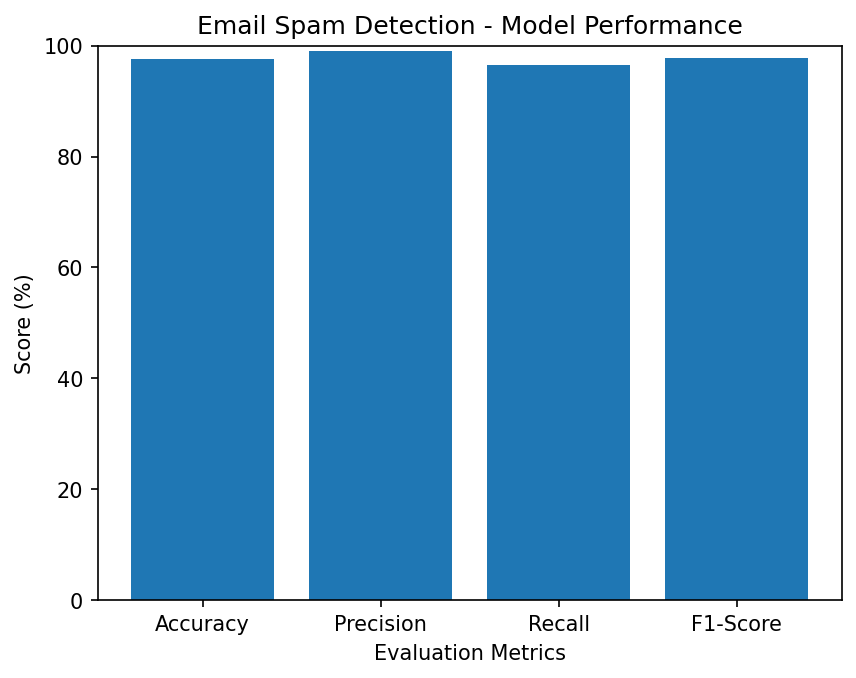

# 📧 Email Spam Detection

A machine learning project that classifies emails as **spam** or **ham** (legitimate) using TF-IDF text features and a Multinomial Naive Bayes model.

## Dataset
- **Source:** [Spam Email Classification Dataset (Kaggle)](https://www.kaggle.com/datasets/purusinghvi/email-spam-classification-dataset)
- Combines the 2007 TREC Public Spam Corpus and the Enron-Spam dataset
- Columns: `label` (1 = spam, 0 = ham) and `text` (the email content)
- The CSV is not included in this repository because of its size. Download `combined_data.csv` and place it in the project folder.

## Technologies Used
- Python
- pandas
- scikit-learn
- matplotlib

## How It Works
1. Load the dataset and remove missing values
2. Split the data into 80% training and 20% testing
3. Convert email text to numbers using **TF-IDF**
4. Train a **Multinomial Naive Bayes** classifier
5. Evaluate with accuracy, precision, recall and F1-score
6. Predict whether new emails are spam or ham

## How to Run
```bash
pip install -r requirements.txt
python app.py
```

## Results

| Metric    | Score  |
|-----------|--------|
| Accuracy  | XX.XX% |
| Precision | XX.XX% |
| Recall    | XX.XX% |
| F1-score  | XX.XX% |



- **Precision:** of all emails predicted as spam, how many really were spam
- **Recall:** of all real spam emails, how many were caught
- **F1-score:** the balance between precision and recall

## Sample Predictions
| Email | Prediction |
|---|---|
| "Congratulations! You won a free iPhone. Click here to claim now!" | SPAM |
| "Hi team, please attend the meeting tomorrow." | HAM |

## Project Structure
```
emailspam/
├── app.py
├── requirements.txt
├── README.md
├── results.png
└── .gitignore
```